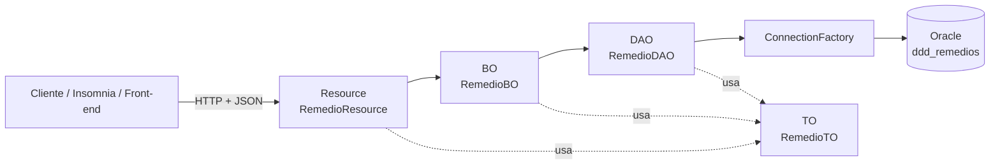

# 💊 MegaFarma - API RESTful de Remédios


API RESTful desenvolvida em **Java com Spring Boot** para gerenciar o cadastro de remédios de uma farmácia fictícia, a **MegaFarma**. A aplicação oferece um CRUD completo (criar, listar, buscar, atualizar e remover) sobre um banco de dados **Oracle**, com validação dos dados de entrada, arquitetura em camadas e suporte a execução via **Docker**.

Projeto acadêmico desenvolvido durante o curso de Análise e Desenvolvimento de Sistemas da **FIAP**.

---

## 📑 Sumário

- [Funcionalidades](#-funcionalidades)
- [Tecnologias e ferramentas](#-tecnologias-e-ferramentas)
- [Arquitetura](#-arquitetura)
- [Estrutura de pastas](#-estrutura-de-pastas)
- [Pré-requisitos](#-pré-requisitos)
- [Como executar localmente](#-como-executar-localmente)
- [Configuração do banco de dados Oracle](#-configuração-do-banco-de-dados-oracle)
- [Variáveis de ambiente](#-variáveis-de-ambiente)
- [Executando com Docker](#-executando-com-docker)
- [Deploy no Render](#-deploy-no-render)
- [Documentação da API](#-documentação-da-api)
- [Exemplos de uso](#-exemplos-de-uso-curl)
- [Regras de validação](#-regras-de-validação)
- [Testes](#-testes)
- [Próximos passos](#-próximos-passos)
- [Autor](#-autor)

---

## ✨ Funcionalidades

- ✅ **Listar** todos os remédios cadastrados, ordenados por código
- ✅ **Buscar** um remédio pelo código
- ✅ **Cadastrar** um novo remédio
- ✅ **Atualizar** os dados de um remédio existente
- ✅ **Remover** um remédio
- ✅ **Validação** automática dos dados enviados (Bean Validation)
- ✅ **CORS** habilitado, permitindo que um front-end em outro domínio consuma a API
- ✅ **Respostas HTTP semânticas** (`200`, `201`, `204`, `400`, `404`)
- ✅ **Credenciais do banco fora do código**, lidas de variáveis de ambiente
- ✅ **Consultas com `PreparedStatement`**, o que protege contra SQL Injection

---

## 🛠 Tecnologias e ferramentas

| Categoria | Tecnologia |
|---|---|
| Linguagem | Java 17 (definido no `pom.xml`) |
| Framework | Spring Boot 3.5.7 (`spring-boot-starter-web`) |
| Validação | Spring Boot Starter Validation (Jakarta Bean Validation) |
| Banco de dados | Oracle Database, via driver JDBC `ojdbc11` |
| Acesso a dados | JDBC puro (padrão DAO) |
| Build | Maven (Maven Wrapper incluído: `mvnw` / `mvnw.cmd`) |
| Testes | JUnit 5 + Spring Boot Starter Test |
| Containerização | Docker (imagem `eclipse-temurin:21-jdk-alpine`) |
| Hospedagem | Render (via Docker) |

Ferramentas úteis para trabalhar com o projeto: **Oracle SQL Developer** (para criar e consultar a tabela), **Insomnia** ou **Postman** (para testar os endpoints), **IntelliJ IDEA** (IDE).

---

## 🏗 Arquitetura

O projeto segue uma arquitetura em camadas, com responsabilidades separadas:



| Camada | Classe | Responsabilidade |
|---|---|---|
| **Resource** | `RemedioResource` | Controller REST. Recebe as requisições, valida o corpo e devolve os status HTTP |
| **Resource** | `CorsFilter` | Filtro que adiciona os cabeçalhos CORS e responde às requisições `OPTIONS` |
| **BO** (Business Object) | `RemedioBO` | Camada de regras de negócio (ponto de extensão para regras futuras) |
| **DAO** (Data Access Object) | `RemedioDAO` | Executa as consultas SQL na tabela `ddd_remedios` |
| **DAO** | `ConnectionFactory` | Cria a conexão JDBC com o Oracle usando variáveis de ambiente |
| **TO** (Transfer Object) | `RemedioTO` | Objeto que trafega os dados entre as camadas, com as regras de validação |

---

## 📂 Estrutura de pastas

```
Aula39-AppWebJava-Farmacia/
├── .mvn/wrapper/                    # Configuração do Maven Wrapper
├── src/
│   ├── main/
│   │   ├── java/br/com/fiap/
│   │   │   ├── MegaFarmaApplication.java      # Classe principal (Spring Boot)
│   │   │   ├── bo/
│   │   │   │   └── RemedioBO.java             # Regras de negócio
│   │   │   ├── dao/
│   │   │   │   ├── ConnectionFactory.java     # Conexão com o Oracle
│   │   │   │   └── RemedioDAO.java            # Acesso a dados (CRUD)
│   │   │   ├── resource/
│   │   │   │   ├── CorsFilter.java            # Configuração de CORS
│   │   │   │   └── RemedioResource.java       # Endpoints REST
│   │   │   └── to/
│   │   │       └── RemedioTO.java             # Modelo + validações
│   │   └── resources/
│   │       └── application.properties
│   └── test/java/br/com/fiap/
│       └── MegaFarmaApplicationTests.java
├── Dockerfile
├── mvnw / mvnw.cmd
└── pom.xml
```

---

## 📋 Pré-requisitos

Para rodar na sua máquina, você precisa de:

- **JDK 17 ou superior** (a imagem Docker usa o JDK 21)
- **Acesso a um banco Oracle** (local, em container ou na nuvem) com a tabela `ddd_remedios` criada. Veja [a próxima seção](#-configuração-do-banco-de-dados-oracle)
- **Git**, para clonar o repositório
- *(Opcional)* **Docker**, para executar em container
- *(Opcional)* **Insomnia** ou **Postman**, para testar a API

> Não é preciso instalar o Maven: o projeto inclui o **Maven Wrapper** (`mvnw`), que baixa a versão correta automaticamente.

---

## 🚀 Como executar localmente

### 1. Baixe o projeto

Na página do repositório no GitHub, clique no botão verde **Code** e escolha uma das opções:

- **Download ZIP**: baixe, extraia e abra a pasta extraída; ou
- **Clone**: copie a URL do repositório e execute `git clone <URL copiada>`.

Em seguida, abra um terminal **dentro da pasta do projeto** (a que contém o arquivo `pom.xml`).

### 2. Crie a tabela no Oracle

Siga a seção [Configuração do banco de dados Oracle](#-configuração-do-banco-de-dados-oracle).

### 3. Configure as variáveis de ambiente

A aplicação **não inicia a conexão com o banco** sem as três variáveis abaixo. Substitua pelos dados do seu banco.

**Linux / macOS (bash)**

```bash
export DB_URL="jdbc:oracle:thin:@//SEU_HOST:1521/SEU_SERVICE_NAME"
export DB_USER="seu_usuario"
export DB_PASSWORD="sua_senha"
```

**Windows (PowerShell)**

```powershell
$env:DB_URL="jdbc:oracle:thin:@//SEU_HOST:1521/SEU_SERVICE_NAME"
$env:DB_USER="seu_usuario"
$env:DB_PASSWORD="sua_senha"
```

**Windows (CMD)**

```cmd
set DB_URL=jdbc:oracle:thin:@//SEU_HOST:1521/SEU_SERVICE_NAME
set DB_USER=seu_usuario
set DB_PASSWORD=sua_senha
```

> 💡 No **IntelliJ IDEA**, você pode definir as variáveis em *Run → Edit Configurations → Environment variables*.

### 4. Execute a aplicação

**Linux / macOS**

```bash
./mvnw spring-boot:run
```

**Windows**

```cmd
mvnw.cmd spring-boot:run
```

### 5. Teste

Com a aplicação no ar, a API fica disponível em:

```
http://localhost:8080/megafarma
```

Abra esse endereço no navegador (ou use o Insomnia) e você deve receber uma lista JSON, vazia (`[]`) se ainda não houver remédios cadastrados.

---

## 🗄 Configuração do banco de dados Oracle

A aplicação usa a tabela **`ddd_remedios`**, com as colunas `codigo`, `nome`, `preco`, `data_de_fabricacao` e `data_de_validade`. Para criá-la, execute o SQL abaixo no **Oracle SQL Developer** (requer Oracle 12c ou superior, por causa da coluna `IDENTITY`):

```sql
CREATE TABLE ddd_remedios (
    codigo              NUMBER GENERATED ALWAYS AS IDENTITY PRIMARY KEY,
    nome                VARCHAR2(100) NOT NULL,
    preco               NUMBER(10, 2) NOT NULL,
    data_de_fabricacao  DATE NOT NULL,
    data_de_validade    DATE NOT NULL
);
```

O `codigo` é gerado automaticamente pelo banco, pois o `INSERT` da aplicação não informa esse campo.

Para cadastrar um remédio de teste direto no banco (opcional):

```sql
INSERT INTO ddd_remedios (nome, preco, data_de_fabricacao, data_de_validade)
VALUES ('Dipirona 500mg', 12.90, DATE '2026-01-15', DATE '2028-01-15');
COMMIT;
```

---

## 🔐 Variáveis de ambiente

| Variável | Obrigatória | Descrição | Exemplo |
|---|---|---|---|
| `DB_URL` | Sim | URL JDBC do banco Oracle | `jdbc:oracle:thin:@//localhost:1521/XEPDB1` |
| `DB_USER` | Sim | Usuário do banco | `megafarma` |
| `DB_PASSWORD` | Sim | Senha do usuário | `********` |

Se alguma delas não estiver definida, a aplicação lança a mensagem: *"Variáveis de ambiente do banco não configuradas!"*.

> ⚠️ **Nunca** coloque usuário, senha ou URL do banco diretamente no código ou no repositório. Use sempre variáveis de ambiente.

---

## 🐳 Executando com Docker

O projeto já possui um `Dockerfile` que compila a aplicação com o Maven Wrapper e executa o `.jar` gerado.

**1. Construa a imagem**

```bash
docker build -t megafarma .
```

**2. Execute o container** (informando as variáveis do banco)

```bash
docker run -p 8080:8080 \
  -e DB_URL="jdbc:oracle:thin:@//SEU_HOST:1521/SEU_SERVICE_NAME" \
  -e DB_USER="seu_usuario" \
  -e DB_PASSWORD="sua_senha" \
  megafarma
```

**3. Acesse** `http://localhost:8080/megafarma`

> Se o Oracle estiver rodando na sua própria máquina, dentro do container use `host.docker.internal` no lugar de `localhost` na `DB_URL`.

---

## ☁️ Deploy no Render

Como o projeto tem `Dockerfile`, ele pode ser publicado no [Render](https://render.com) como **Web Service** com ambiente Docker:

1. Faça o push do projeto para o seu repositório no GitHub.
2. No Render, clique em **New → Web Service** e conecte o repositório.
3. Em **Language/Runtime**, escolha **Docker** (o Render detecta o `Dockerfile` na raiz).
4. Em **Environment**, cadastre as variáveis `DB_URL`, `DB_USER` e `DB_PASSWORD`.
5. Recomendado: cadastre também `PORT=8080`, para o Render encaminhar o tráfego à porta em que o Spring Boot sobe por padrão.
6. Clique em **Create Web Service** e aguarde o build.

> O banco Oracle precisa estar acessível pela internet a partir do Render (liberar IP/porta no provedor do banco).

---

## 📡 Documentação da API

**URL base:** `/megafarma` (local: `http://localhost:8080/megafarma`)

| Método | Endpoint | Descrição | Sucesso | Erros |
|---|---|---|---|---|
| `GET` | `/megafarma` | Lista todos os remédios | `200 OK` | n/a |
| `GET` | `/megafarma/{codigo}` | Busca um remédio pelo código | `200 OK` | `404 Not Found` |
| `POST` | `/megafarma` | Cadastra um remédio | `201 Created` | `400 Bad Request` |
| `PUT` | `/megafarma/{codigo}` | Atualiza um remédio | `201 Created` | `400 Bad Request` |
| `DELETE` | `/megafarma/{codigo}` | Remove um remédio | `204 No Content` | `404 Not Found` |

### Modelo do objeto (JSON)

```json
{
  "codigo": 1,
  "nome": "Dipirona 500mg",
  "preco": 12.90,
  "dataDeFabricacao": "2026-01-15",
  "dataDeValidade": "2028-01-15"
}
```

| Campo | Tipo | Descrição |
|---|---|---|
| `codigo` | número (Long) | Identificador gerado pelo banco. Não precisa ser enviado no `POST`. No `PUT`, vem da URL |
| `nome` | texto | Nome do remédio |
| `preco` | número (decimal) | Preço do remédio |
| `dataDeFabricacao` | data (`AAAA-MM-DD`) | Data de fabricação |
| `dataDeValidade` | data (`AAAA-MM-DD`) | Data de validade |

### Observações sobre as respostas

- `POST` devolve o objeto enviado no corpo da requisição.
- `PUT` usa o `codigo` da URL (qualquer `codigo` no corpo é ignorado) e devolve o objeto atualizado com status `201`.
- Mensagens de erro de `404` retornam o texto `Remédio não encontrado`.

---

## 🧪 Exemplos de uso (cURL)

> Datas de exemplo; ajuste para que a fabricação seja **hoje ou antes** e a validade seja **hoje ou depois**.

**Cadastrar um remédio**

```bash
curl -X POST http://localhost:8080/megafarma \
  -H "Content-Type: application/json" \
  -d '{
        "nome": "Dipirona 500mg",
        "preco": 12.90,
        "dataDeFabricacao": "2026-01-15",
        "dataDeValidade": "2028-01-15"
      }'
```

**Listar todos**

```bash
curl http://localhost:8080/megafarma
```

**Buscar por código**

```bash
curl http://localhost:8080/megafarma/1
```

**Atualizar**

```bash
curl -X PUT http://localhost:8080/megafarma/1 \
  -H "Content-Type: application/json" \
  -d '{
        "nome": "Dipirona 1g",
        "preco": 18.50,
        "dataDeFabricacao": "2026-01-15",
        "dataDeValidade": "2028-06-30"
      }'
```

**Remover**

```bash
curl -X DELETE http://localhost:8080/megafarma/1
```

### Testando pelo Insomnia / Postman

1. Crie uma requisição com o método e a URL desejados (ex.: `POST http://localhost:8080/megafarma`).
2. Em **Body**, selecione **JSON** e cole o modelo do objeto.
3. Envie e confira o status e o corpo da resposta.

---

## ✔️ Regras de validação

Os dados enviados em `POST` e `PUT` são validados automaticamente. Se alguma regra for violada, a API responde com `400 Bad Request`.

| Campo | Regra | Significado |
|---|---|---|
| `nome` | `@NotBlank` | Obrigatório e não pode ser vazio |
| `preco` | `@NotNull` + `@PositiveOrZero` | Obrigatório e maior ou igual a zero |
| `dataDeFabricacao` | `@NotNull` + `@PastOrPresent` | Obrigatória e não pode estar no futuro |
| `dataDeValidade` | `@NotNull` + `@FutureOrPresent` | Obrigatória e não pode estar no passado |

---

## 🧰 Testes

O projeto possui um teste de carga de contexto do Spring (`MegaFarmaApplicationTests`), que verifica se a aplicação sobe corretamente.

```bash
./mvnw test        # Linux / macOS
mvnw.cmd test      # Windows
```

---

## 🔭 Próximos passos

Ideias de evolução do projeto:

- [ ] Criar testes automatizados para a camada de negócio e para os endpoints
- [ ] Migrar o acesso a dados para Spring Data JPA, com pool de conexões
- [ ] Usar injeção de dependência do Spring (`@Service`, `@Repository`) no lugar de `new`
- [ ] Tratamento global de exceções com `@RestControllerAdvice`
- [ ] Restringir a origem permitida no CORS para o domínio do front-end
- [ ] Documentar a API com Swagger / OpenAPI
- [ ] Incluir o script SQL de criação da tabela no repositório
- [ ] Criar um front-end para consumir a API

---

## 👨‍💻 Autor

**Tárik Moussa Alma**
Estudante de Análise e Desenvolvimento de Sistemas, FIAP.

[](https://github.com/cearaa)
[](https://www.linkedin.com/in/rikk-alma/)
